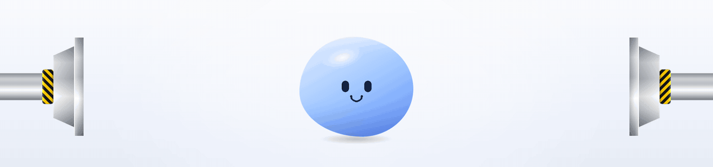
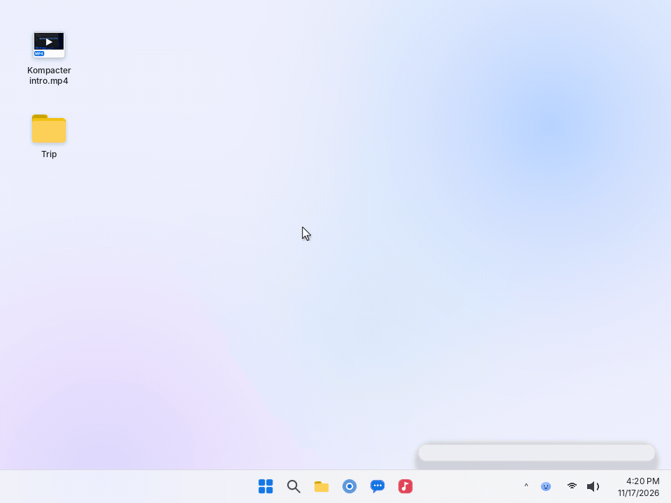

<p align="center"></p>

# Kompacter

Compress any file, any time. With better quality and more for those apps. All local.

Copy a file that's too big for Discord (or email, or any app with an upload limit), and Kompacter shrinks it to fit, puts it back on your clipboard, and you paste. Videos, audio, images, documents, 3D models, whole folders. Nothing is uploaded anywhere: every byte stays on your computer. Runs on Windows, Linux and macOS.

> Status: early development. One app and one compression engine on Windows, Linux and macOS. Windows draws with Skia, Linux and macOS with FemtoVG (OpenGL) or the software renderer. Media jobs run in FFmpeg, with hardware encoding on supported GPUs. Windows has the most automatic features today (see the table under Features).

## Download

Get Kompacter from [Releases](https://github.com/KXZer0/Kompacter/releases). Every download has a `.sha256` checksum next to it.

| System | Download | Notes |
|---|---|---|
| Windows 10/11 | `Kompacter-<version>-setup.exe` | No admin rights needed; ffmpeg is included. Updates itself. |
| Linux (x86-64) | `Kompacter-<version>-x86_64.AppImage` | ffmpeg is included. `chmod +x` it and run it. Needs glibc 2.35+ (Ubuntu 22.04, Debian 12, Fedora 36 or newer) and the usual desktop OpenGL/Wayland/X11 libraries. |
| Debian / Ubuntu | `kompacter_<version>_amd64.deb` | `sudo apt install ./kompacter_<version>_amd64.deb` ffmpeg is included. |
| Linux, portable | `Kompacter-<version>-linux-x86_64.tar.gz` | Extract and run `./Kompacter`; ffmpeg is included; `./install-launcher.sh` adds a menu entry. |
| macOS (Apple Silicon) | `Kompacter-<version>-macos-arm64.dmg` | Open it and drag Kompacter to Applications; ffmpeg is included. |
| macOS (Intel) | `Kompacter-<version>-macos-x86_64.dmg` | Same as above. |

Until the macOS builds are notarized, macOS blocks the first start: right-click Kompacter in Applications → **Open** → **Open** (or run `xattr -dr com.apple.quarantine /Applications/Kompacter.app`).

## See it

**Drop a file, press Compress, paste.** It picks the resolution and bitrate that fit, and the result is already on your clipboard.

<p align="center"></p>

**Trim first.** Drag the handles and the size and quality update as you go; keep quality, fit the limit, or make a GIF.

<p align="center"></p>

**Whole folders.** Every video, photo and document inside is shrunk on its own (the limit is shared out by size), then it's zipped. You see before → after for each file first.

<p align="center"></p>

**Settings.** Pick the limit (Discord, Nitro, email, custom), the look, where results go, a compression preference (Compatibility, Balanced or Efficiency) with optional per-format overrides, and what Kompacter may do on its own. Hover a feature to see it in action.

<p align="center"></p>

## Why

- **Web compressors** upload your files to someone else's server, and you still have to download and re-attach the result.
- **Existing desktop tools** handle one file type (usually video) or one OS.
- **Kompacter** handles everything, runs locally with your GPU on Windows, Linux and macOS, and is built for "share this clip right now".

## Features (planned for v1)

- Fits files under a target size: Discord 20 / 50 / 500 MB, Slack 1 GB, WhatsApp 2 GB, Telegram 2 GB, Signal 100 MB, email 25 MB, or custom.
- **Compression preference:** Compatibility (plays everywhere, fastest), Balanced, or Efficiency (smallest files, slower). Any output format can be pinned to override it.
- **Trim + compress** with live size and quality estimates while you drag the handles.
- Videos are checked after encoding, so a result always plays and is always under the limit. A video that already fits is left untouched; one in a container chat apps dislike (MOV, MKV, WebM) is repackaged to MP4 without re-encoding.
- Pictures keep their colour profile (Display P3 screenshots, phone photos), their orientation and their transparency. HDR pictures are tone-mapped. iPhone HEIC and AVIF photos become JPEGs (or WebP with the Efficiency preference) that fit.
- Animated GIFs stay GIFs, and animated PNG and WebP become GIFs, so they autoplay in every chat app.
- Folders: shrinks every video, picture, document and model inside, then zips (several zips that each fit, if one can't).
- Documents (PDF, Word, PowerPoint, Excel, EPUB, CBZ) and 3D models (glTF/GLB) stay documents and models: only the pictures and textures inside are shrunk.
- Zip and 7z files: opened, the media inside shrunk, packed again the same way.
- Logs, CSVs and other text: a 7z when a zip isn't small enough.
- Short clips as **GIFs** that fit.
- Results go to Kompacter's folder, next to the original, a folder you pick, or replace the original (which goes to the Recycle Bin or Trash).
- Lives in the tray or menu bar. Open it by dropping a file, choosing one, pasting, or from the file manager.
- Updates itself: a new version is checked against its published checksum, with a short "What's new". Can be switched off.
- No admin rights needed. No account. No network access except update checks.

| | Windows | Linux | macOS |
|---|---|---|---|
| Drop, choose or paste files; compress; copy the result to the clipboard | ✓ | ✓ | ✓ |
| Tray / menu-bar app, single instance | ✓ | ✓ (tray when the desktop has one) | ✓ |
| Open files from the file manager | Right-click **Kompact** in Explorer | "Open with" / launcher | Finder "Open with" / Dock |
| Shrink new clips in watched clip folders (Medal, Game Bar, ShadowPlay, OBS…) | ✓ | ✓ | ✓ |
| Replace the original (to the Recycle Bin / Trash) | ✓ | ✓ | ✓ |
| Hotkey quick bar (Ctrl+Alt+K; ⌃⌥K on macOS) for what you copied | ✓ | ✓ on desktops with the global-shortcuts portal (GNOME 48+, KDE) | ✓ |
| Paste guard: a too-big paste into Discord, Slack, WhatsApp, Telegram or Signal is shrunk to that app's limit | ✓ | — (not allowed on Wayland) | ✓ (needs Accessibility permission) |
| Notice when a too-big file is copied | ✓ | ✓ (Wayland on KDE, Sway and other wlroots desktops; not GNOME) | ✓ |
| Start with the system | ✓ | ✓ (XDG autostart) | ✓ (Open at login) |
| Updates | Installs itself on restart | AppImage replaces itself; .deb and tarball open the release page | Opens the release page |

## Repository layout

```
crates/
  kompacter-core/   compression engine (Rust library): probe, plan, video/audio/image/folder jobs
    tests/          engine tests (run by `cargo test`, not part of the app)
  kompacter-cli/    `kompacter` command-line tool on top of the engine
apps/
  kompacter/        desktop app: Slint UI (frontend/*.slint) + Rust logic
                    src/app/       flow, settings, trimmer, updates (shared by every OS)
                    src/platform/  windows/, linux/, macos.rs: clipboard, tray, trash, activation
packaging/
  windows/          NSIS installer
  linux/            AppImage, .deb and portable tarball
  macos/            .app bundle, DMG, signing and notarization
docs/
  ARCHITECTURE.md   how the pieces fit together
  ROADMAP.md        phases, hooks/triggers plan, open decisions
  RELEASING.md      how releases are built, signed and published
  TESTING.md        what is tested and how
tools/media/        scripts that record the README demos from the real app
```

## Try the engine

Needs Rust and ffmpeg on your PATH (or set `KOMPACTER_FFMPEG` / `KOMPACTER_FFPROBE`).

```bash
cargo build --release
./target/release/kompacter compress clip.mp4 --target discord
./target/release/kompacter compress clip.mp4 --target 20mb --start 12 --end 40
./target/release/kompacter compress clip.mp4 --start 12 --end 40 --keep-quality
./target/release/kompacter estimate clip.mp4 --target 20mb --start 0 --end 30
./target/release/kompacter compress ./photos --target 25mb
```

`estimate` prints the resolution, bitrate and quality badge the trimmer UI will show, without encoding anything.

## Run the app from source

```bash
cargo run -p kompacter
```

Linux builds need the fontconfig headers (`sudo apt install libfontconfig-dev` on Debian/Ubuntu); at runtime the app needs ffmpeg plus the usual desktop libraries (OpenGL/EGL, libxkbcommon and libxkbcommon-x11, Wayland client). macOS needs the Xcode command-line tools and `brew install ffmpeg`.

## License

Copyright (C) 2026 LS. Kompacter is free software under the [GNU Affero General Public License, version 3](LICENSE) (AGPL-3.0). Kompacter calls ffmpeg as a separate program; ffmpeg has its own LGPL/GPL license.

The window is drawn with [Slint](https://slint.dev), used under its royalty-free license.

[](https://slint.dev)
