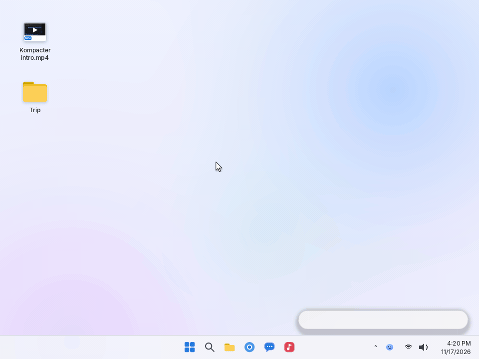
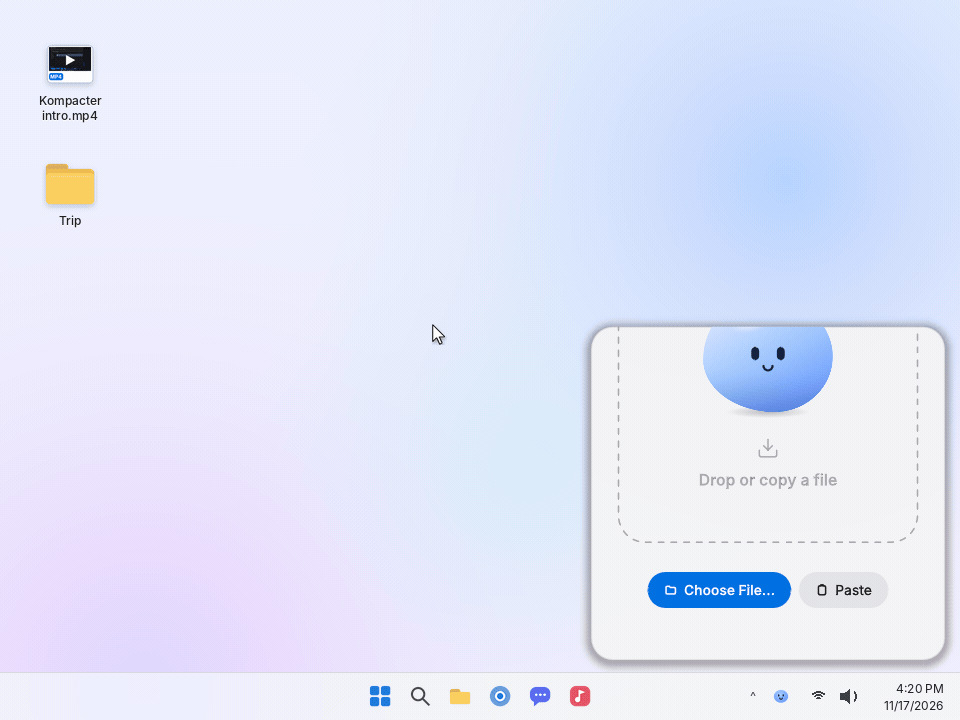

<p align="center"></p>

# Kompacter

Compress any file, any time. With better quality and more for those apps. All local.

Copy a file that's too big for Discord (or email, or any app with an upload limit), and Kompacter shrinks it to fit, puts it back on your clipboard, and you paste. Videos, audio, images, documents, 3D models, whole folders. Nothing is uploaded anywhere: every byte stays on your PC.

> Status: early development. The Windows tray app uses Skia CPU rendering. Media jobs run in FFmpeg, with hardware encoding available on supported GPUs.

## Download

Grab the Windows installer from [Releases](https://github.com/KXZer0/Kompacter/releases). No admin rights needed; ffmpeg is included.

## See it

**Drop a file, press Compress, paste.** It picks the resolution and bitrate that fit, and the result is already on your clipboard.

<p align="center"></p>

**Trim first.** Drag the handles and the size and quality update as you go; keep quality, fit the limit, or make a GIF.

<p align="center"></p>

**Whole folders.** Every video, photo and document inside is shrunk on its own (the limit is shared out by size), then it's zipped. You see before → after for each file first.

<p align="center"></p>

**Settings.** Pick the limit (Discord, Nitro, email, custom), the look, where results go, output formats, and what Kompacter may do on its own. Hover a feature to see it in action.

<p align="center"></p>

## Why

- **Web compressors** upload your files to someone else's server, and you still have to download and re-attach the result.
- **Existing desktop tools** handle one file type (usually video) or one OS.
- **Kompacter** handles everything, runs locally with your GPU, and is built for "share this clip right now".

## Features (planned for v1)

- Fits files under a target size: Discord 20 / 50 / 500 MB, email 25 MB, or custom.
- **Trim + compress** with live size and quality estimates while you drag the handles.
- Folders: shrinks every video, picture, document and model inside, then zips (several zips that each fit, if one can't).
- Documents (PDF, Word, PowerPoint, Excel, EPUB, CBZ) and 3D models (glTF/GLB) stay documents and models: only the pictures and textures inside are shrunk.
- Zip and 7z files: opened, the media inside shrunk, packed again the same way.
- Animated GIFs stay GIFs. iPhone HEIC and AVIF photos become JPEGs that fit.
- Logs, CSVs and other text: a 7z when a zip isn't small enough.
- Short clips as **GIFs** that fit.
- Lives in the tray. Open it by dropping a file, right-clicking **Kompact** in Explorer, a hotkey (Ctrl+Alt+K opens a small quick bar for what you copied), or the optional paste guard that notices a too-big paste into Discord.
- Optional: shrink new clips in your clip folders (Medal, Game Bar, ShadowPlay, OBS) on their own.
- Updates itself: a new version downloads in the background, is checked against its published checksum, and installs on the next restart (with a short "What's new"). Can be switched off.
- No admin rights needed. No account. No network access except update checks.

## Repository layout

```
crates/
  kompacter-core/   compression engine (Rust library): probe, plan, video/audio/image/folder jobs
  kompacter-cli/    `kompacter` command-line tool on top of the engine
apps/
  kompacter/        tray app: Slint UI (ui/*.slint) + Rust logic (src/), Windows first
docs/
  ARCHITECTURE.md   how the pieces fit together
  ROADMAP.md        phases, hooks/triggers plan, open decisions
tools/media/        scripts that record the README demos from the real app
```

## Try the engine

Needs Rust and ffmpeg on your PATH (or set `KOMPACTER_FFMPEG` / `KOMPACTER_FFPROBE`).

```bash
cargo build --release
./target/release/kompacter compress clip.mp4 --target discord
./target/release/kompacter compress clip.mp4 --target 20mb --start 12 --end 40
./target/release/kompacter compress clip.mp4 --start 12 --end 40 --keep-quality
./target/release/kompacter estimate clip.mp4 --target 20mb --start 0 --end 30
./target/release/kompacter compress ./photos --target 25mb
```

`estimate` prints the resolution, bitrate and quality badge the trimmer UI will show, without encoding anything.

## Run the app from source

```bash
cargo run -p kompacter
```

## License

Copyright (C) 2026 LS. Kompacter is free software under the [GNU Affero General Public License, version 3](LICENSE) (AGPL-3.0). Kompacter calls ffmpeg as a separate program; ffmpeg has its own LGPL/GPL license.

The window is drawn with [Slint](https://slint.dev), used under its royalty-free license.

[](https://slint.dev)
